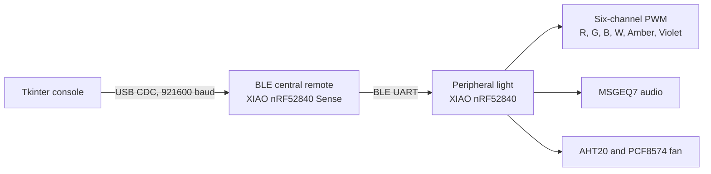
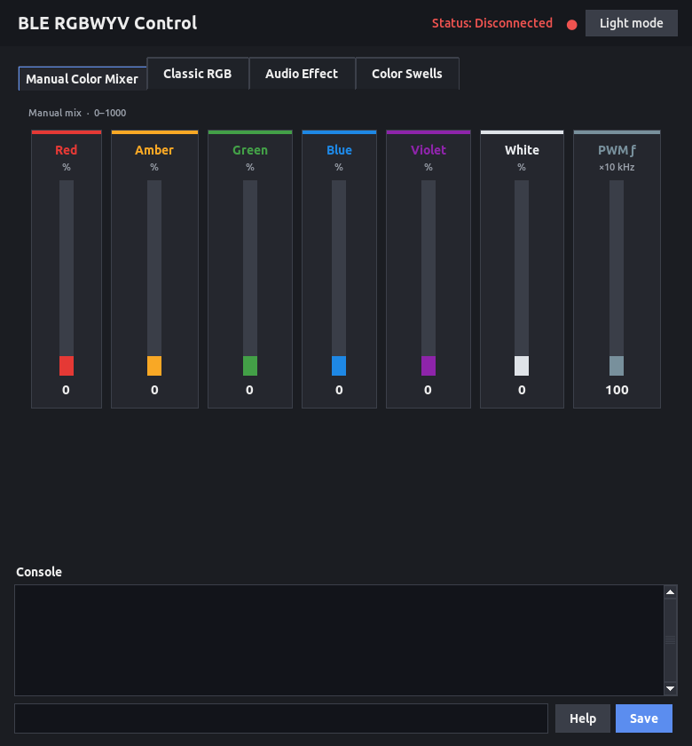
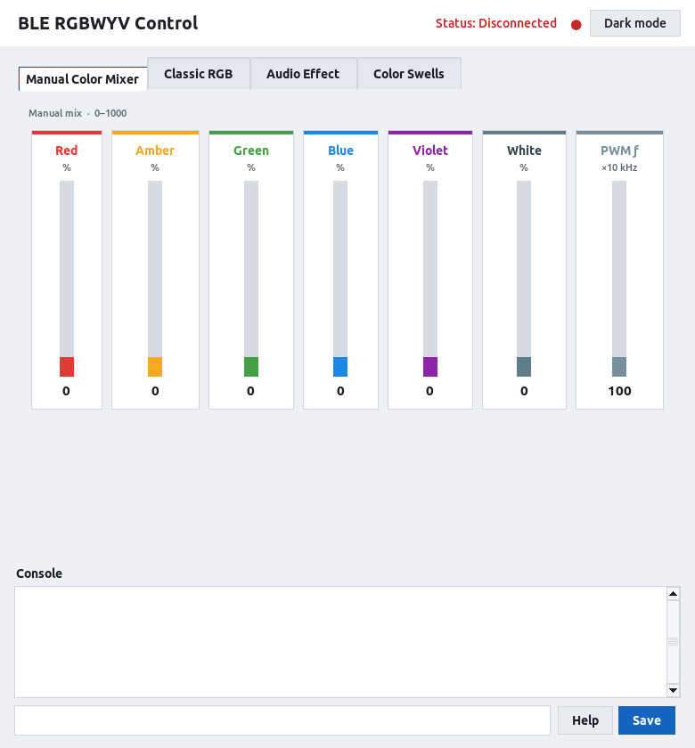

# RGBWYV-Light


RGBWYV-Light is a six-channel LED lamp — red, green, blue, white, amber, and violet — built around two [Seeed XIAO nRF52840](https://wiki.seeedstudio.com/XIAO_BLE/) boards. A Tkinter desktop console talks USB CDC at 921600 baud to a BLE central remote, which bridges newline-terminated ASCII commands over BLE UART to the peripheral light.

- [Features](#features)
- [Architecture](#architecture)
- [Hardware](#hardware)
- [Bill of materials](#bill-of-materials)
- [Hardware status](#hardware-status)
- [Serial command reference](#serial-command-reference)
- [Saved data format](#saved-data-format)
- [Building and flashing](#building-and-flashing)
- [Console](#console)
- [Repository layout](#repository-layout)
- [Roadmap](#roadmap)
- [Contributing](#contributing)
- [License](#license)

## Features

- Four operating modes:
  - **0 — Classic RGB:** a red–green–blue rainbow swell
  - **1 — Audio:** seven-band MSGEQ7 visualization; the white channel stays off
  - **2 — Manual:** direct mixer for all six channels and PWM frequency
  - **3 — Color Swells (retro):** red–green–violet color swells
- AHT20 temperature sensing
- Fan control through a PCF8574 I/O expander at address `0x20`, with automatic hysteresis (on at 35 °C, off at 32 °C) plus manual `fan0` / `fan1` commands
- Save and load of the 59 mixer parameters and the current mode to the light's internal filesystem

## Architecture



The central remote identifies itself as `LED Console 001` (manufacturer `Doug's Garage`). The light reports model `LED Device 001` over the BLE Device Information Service. The console auto-detects the remote by sending `*idn` and matching the reply in `config.ini`.

## Hardware

The light uses a Seeed XIAO nRF52840 (plain, not Sense). The remote uses a Seeed XIAO nRF52840 Sense, and in the current firmware it is only a USB-to-BLE bridge — the central sketch does not drive header GPIO.

**All MCU header pins are 3.3 V only and are not 5 V tolerant.** The MSGEQ7 and any logic tied to those pins must run at 3.3 V or be level-shifted.

### Peripheral pin map

Verified from `RGB_Peripheral_Device_R2/main/main.ino`. On the Seeeduino nRF52 core, Arduino pin `n` is header `Dn`.

| Function | Firmware | Header pin |
|----------|----------|------------|
| Red PWM | `RED_PIN 7` | D7 |
| Green PWM | `GREEN_PIN 2` | D2 |
| Blue PWM | `BLUE_PIN 8` | D8 |
| White PWM | `WHITE_PIN 6` | D6 |
| Amber PWM | `AMBER_PIN 9` | D9 |
| Violet PWM | `VIOLET_PIN 3` | D3 |
| MSGEQ7 analog out | `analogPin A0` | A0 (D0) |
| MSGEQ7 reset | `resetPin 1` | D1 |
| MSGEQ7 strobe | `strobePin 10` | D10 |
| I2C SDA / SCL | default `Wire` | D4 / D5 |
| PCF8574 | `pcf.begin(0x20, &Wire)` | address `0x20`; fan on expander pin 2 |
| AHT20 | `Adafruit_AHTX0` on `Wire` | same I2C bus |

KiCad schematics, PCB, and Gerbers are in `RGBYVW_Schematic_PCB/`. The board includes MOSFET LED drivers, the MSGEQ7, and an AHT20.

PWM frequency is set by `adc55` (a value of 1000 = 10 kHz maximum) and is applied in manual and audio modes.

## Bill of materials

Main light board (`nRF52840_RGBWYV`), generated by KiCad from the schematic and grouped by value and footprint (52 parts). The CSV is [`RGBYVW_Schematic_PCB/BOM.csv`](RGBYVW_Schematic_PCB/BOM.csv); per-schematic BOMs and ERC/DRC reports are in [`RGBYVW_Schematic_PCB/reports/`](RGBYVW_Schematic_PCB/reports/). The original hand-written BOM, including the mechanical parts, is [`BOM_R3_source.txt`](RGBYVW_Schematic_PCB/BOM_R3_source.txt).

| Qty | References | Value | Footprint |
|----:|------------|-------|-----------|
| 1 | AHT20 | Conn_01x04 | `Connector_PinHeader_2.54mm:PinHeader_1x04_P2.54mm_Vertical` |
| 1 | C1 | 100uF | `Capacitor_THT:CP_Radial_D10.0mm_P3.80mm` |
| 1 | C2 | 33pF CoG 50V 0402 | `Capacitor_SMD:C_0402_1005Metric_Pad0.74x0.62mm_HandSolder` |
| 1 | C3 | 0.1uF CoG 50V 0704 | `Capacitor_SMD:C_0603_1608Metric_Pad1.08x0.95mm_HandSolder` |
| 1 | C4 | 22uF-10uF | `Capacitor_SMD:C_0603_1608Metric_Pad1.08x0.95mm_HandSolder` |
| 4 | C5-C8 | 0.1uF XR7 0603 | `Capacitor_SMD:C_0603_1608Metric_Pad1.08x0.95mm_HandSolder` |
| 2 | D1, D3 | SDM05U20S3-7 20V 500mA | `Diode_SMD:D_SOD-323_HandSoldering` |
| 1 | D2 | 12 pin LED | `KiCad User Library:12 pin LED` |
| 1 | J1 | Screw_Terminal_01x02 | `TerminalBlock:TerminalBlock_Xinya_XY308-2.54-2P_1x02_P2.54mm_Horizontal` |
| 1 | J2 | Screw_Terminal_01x03 | `TerminalBlock:TerminalBlock_Xinya_XY308-2.54-3P_1x03_P2.54mm_Horizontal` |
| 1 | J3 | Conn_01x04 (screw terminal) | `TerminalBlock:TerminalBlock_Xinya_XY308-2.54-4P_1x04_P2.54mm_Horizontal` |
| 1 | J4 | Fan WINSINN 2010 | `Connector_JST:JST_XH_B2B-XH-A_1x02_P2.50mm_Vertical` |
| 7 | Q1-Q7 | IRLML6244 | `Package_TO_SOT_SMD:SOT-23` |
| 2 | R1, R3 | 22kΩ | `Resistor_SMD:R_0603_1608Metric_Pad0.98x0.95mm_HandSolder` |
| 1 | R2 | 221kΩ 0805 | `Resistor_SMD:R_0805_2012Metric_Pad1.20x1.40mm_HandSolder` |
| 9 | R4-R9, R17-R19 | 10kΩ | `Resistor_SMD:R_0603_1608Metric_Pad0.98x0.95mm_HandSolder` |
| 6 | R10-R15 | 4.7Ω | `Resistor_THT:R_Axial_DIN0309_L9.0mm_D3.2mm_P12.70mm_Horizontal` |
| 1 | R16 | 100Ω | `Resistor_SMD:R_0603_1608Metric_Pad0.98x0.95mm_HandSolder` |
| 1 | U1 | L7805 | `Package_TO_SOT_THT:TO-220-3_Horizontal_TabDown` |
| 1 | U2 | MSGEQ7 | `Package_DIP:DIP-8_W7.62mm` |
| 1 | U3 | PCF8574T | `Package_SO:SOIC-16W_7.5x10.3mm_P1.27mm` |
| 6 | U4-U9 | LM317_TO-220 | `Package_TO_SOT_THT:TO-220-3_Vertical` |
| 1 | U10 | nRF52840_XAIO | `A_USER_FOOTPRINTS:XAIO-nRF528400-TTH` |

`D2` and `U10` use the project's custom KiCad parts (`User` / `A_USER_Library` symbols, `KiCad User Library` / `A_USER_FOOTPRINTS` footprints). The symbols and footprints are embedded in the schematic and board files, so they open and plot without the libraries; the standalone library files are not in this repo.

### Mechanical / hardware

From [`BOM_R3_source.txt`](RGBYVW_Schematic_PCB/BOM_R3_source.txt). Dimensions, fits and assembly notes are in [`mechanical/README.md`](mechanical/README.md).

| Item | Value / PN | Qty | Notes | Link |
|------|------------|----:|-------|------|
| Wooden box | Amazon part | 1 | 95.5 × 87 × 62 mm outer, 3 mm floor, 22 mm lid | [Amazon](https://www.amazon.com/dp/B0B51L68YK) |
| Reflector cone | Amazon part | 1 | 48 mm mouth, 12 mm LED hole; cut to 29.2 mm (flush with the lid) | [Amazon](https://www.amazon.com/dp/B07MS8N2DS) |
| Fan 30 × 30 × 10 mm | Sunon MF30100V1-1000U-A99 | 1 | 5 V, 24 mm holes (check voltage vs the circuit) | [Digi-Key](https://www.digikey.com/en/products/detail/sunon-fans/MF30100V1-1000U-A99/10441403) |
| Fan grill, 3D printed | `mechanical/parts/fan_grill_30mm.stl` | 1 | 36 × 36 × 2 mm, outside of the floor | |
| M3 flat-head screws + thin nuts (grill) | ISO 10642 / DIN 439 | 4 + 4 | M3 × 18 (grill 2 + floor 3 + fan 10) | |
| 2.1 mm DC jack | uxcell a14103100ux0223 | 1 | 2.1 × 5.5, M8 panel mount, 20 mm overall | [Amazon](https://www.amazon.com/dp/B01C8CRCJ4) |
| USB-C breakout (horizontal) | Amabro | 1 | Plate glued in its wall pocket | [Amazon](https://www.amazon.com/dp/B0H9S9C73Q) |
| 3.5 mm stereo jack (TRS) | CESS 318 | 1 | M6 panel mount, 20 mm overall | [Amazon](https://www.amazon.com/dp/B00ZYWILMS) |
| Screw terminals 2.54 mm (J1 2P, J2 3P, J3 4P) | JSZAAHZ 46-pc kit | 1 kit | KF128/DG308-2.54 style | [Amazon](https://www.amazon.com/dp/B0FCXV6GT3) |
| AHT20 module | UMLIFE | 1 | 15.11 × 10.41 mm, 4-pin I2C | [Amazon](https://www.amazon.com/dp/B09B9ZWSDZ) |
| Male pin header 2.54 mm | 1 × 40 breakaway | 1 | 18 pins: XIAO 2 × 1x7, AHT20 1x4 | |
| Vent eyelets | chrome, 5 mm ID | 5 | already on the box | |
| Enclosure feet | source unknown | 4 | 5 mm dia × 5 mm | |
| M3 standoffs | M3 × 26 mm F-F | 4 | | |
| M3 button-head screws | | 4 | M3 × 5–6 mm (board to standoffs) | |
| M3 countersunk screws | | 4 | M3 × 8 mm (3 mm floor to standoffs) | |
| LED heatsink | uxcell 30 × 20 × 10 (10-pack) | 1 | pre-applied thermal pad | [Amazon](https://www.amazon.com/dp/B093V778LH) |
| TO-220 heatsink (LM317) | Adam Tech HSK-059-04 | 6 | 35 mm cut to 20 mm; U5/U7 fins filed to 5.0 mm | [Digi-Key](https://www.digikey.com/en/products/detail/adam-tech/HSK-059-04/26224094), [alt](https://www.amazon.com/gp/product/B0CG91KN14) |
| M3 screws (TO-220 sinks) | | 6 | M3 × 6 mm pan head | |
| Thermal paste | — | as needed | LM317 TO-220 tabs only | |
| Insulating thermal tape | 3M 8810 | 1 | LED pad — the pad is electrically live, so no paste or epoxy there | [Adafruit](https://www.adafruit.com/product/1467) |
| Epoxy | — | as needed | Not on the LED pad | |

## Hardware status

- **Main light board (`nRF52840_RGBWYV`)**: ERC has 0 errors and 11 warnings; DRC with schematic parity has 0 unconnected pads, 9 parity/footprint errors (the new fan-circuit parts that are not on the PCB yet), and 42 warnings. All other items are library warnings: footprints and symbols that differ from the newer KiCad 10 library copies, plus the custom libraries noted above.
- **Fan circuit (schematic only)**: an on-board PCF8574T (`U3`, I2C address `0x20`) drives fan pin P2 through `Q7`, a low-side IRLML6244. The circuit also adds the gate resistors `R16` and `R17`, the flyback diode `D3`, the JST-XH fan connector `J4` (WINSINN 2010, 5 V rail), the decoupling cap `C8`, and the I2C pull-ups `R18` and `R19`. These parts are **not on the PCB yet**; run *Tools → Update PCB from Schematic* in KiCad and place and route them. If an external PCF8574 module is still plugged into `J3`, remove it, because both would answer at `0x20`.
- **Controller (`nRF52840_Controller`)**: schematic only, no PCB yet. ERC has 0 errors and 3 warnings. The remaining warnings are the custom XIAO library, and the `BL` backlight label tied to 3V3 (intentional).
- **`RGBYVW_R2`**: a superseded draft that `nRF52840_RGBWYV` replaces. Its schematic ERC is down to 0 errors, but its PCB has known layout problems (shorts, clearance violations, duplicate footprints, unrouted nets). It is kept for reference only; don't fabricate it.

## Serial command reference

Commands are newline-terminated ASCII. Carriage returns are ignored, so CRLF is treated as a single line. The console and the central speak USB CDC at 921600 baud. The central handles a short local command set and, when a BLE connection is up, forwards every other complete line to the light over BLE UART.

### Central (USB)

| Command | Action |
|---------|--------|
| `*idn` | Print the central name (`LED Console 001`) |
| `help` | Print the command menu |
| `info` | Print the connected peripheral's manufacturer and model |

### Peripheral (via the central)

| Command | Action |
|---------|--------|
| `adcN,V` | Set parameter `N` (0–58) to `V`, where `V` is 0–1000 (1000 = 1.0) |
| `mode,0` … `mode,3` | Select a mode. All six PWM channels are zeroed on a mode change; manual mode then applies the current mix |
| `save` | Write the current 59 `adc[]` values and the mode to `data.txt` |
| `read` | Print the saved file and reload it into RAM |
| `val?` | Print the live RAM snapshot (59 values plus mode) |
| `dele` | Delete the saved `data.txt` file |
| `temp` | Print the AHT20 temperature in Celsius |
| `fan0` / `fan1` | Turn the fan off or on and update the stored fan state |
| `err?` | Print I2C health: `tempI2C=` and `fanI2C=` (`1` = good, `0` = bad) |

### `adc` parameter map

**Audio mode** (seven MSGEQ7 bands: 63 Hz, 160 Hz, 400 Hz, 1 kHz, 2.5 kHz, 6.25 kHz, 16 kHz):

| Channels | Meaning |
|----------|---------|
| `adc0`–`adc6` | Red mixer, one weight per band |
| `adc7`–`adc13` | Amber mixer |
| `adc14`–`adc20` | Green mixer |
| `adc21`–`adc27` | Blue mixer |
| `adc28`–`adc34` | Violet mixer |
| `adc35`–`adc41` | Upper thresholds |
| `adc42`–`adc48` | Lower thresholds |

**Manual mode:**

| Channel | Meaning |
|---------|---------|
| `adc49` | Red |
| `adc50` | Amber |
| `adc51` | Green |
| `adc52` | Blue |
| `adc53` | Violet |

**Classic RGB and color swells:**

| Channel | Meaning |
|---------|---------|
| `adc56` | Speed |
| `adc57` | Pastel / white level |
| `adc58` | Brightness (color amplitude) |

**Always present:**

| Channel | Meaning |
|---------|---------|
| `adc54` | White LED (held at zero while audio mode is running) |
| `adc55` | PWM frequency, 10 kHz max (1000 = 10 kHz) |

## Saved data format

`save` writes one CSV schema: all 59 `adc[]` values as thousandths, then the mode integer. `val?` uses the same layout from live RAM.

`data.txt` files written by the older R2 firmware use a different scale for channels 49–55. After flashing this firmware, set the sliders you care about and send **Save** once (or `dele` followed by `save`) before trusting a restored mix.

## Building and flashing

Use the **Seeed nRF52 Boards** core (`Seeeduino:nrf52` 1.1.13), not the Adafruit nRF52 package and not “Seeed nRF52 mbed-enabled Boards.” The mbed core numbers D6–D10 differently; this firmware uses bare pin integers, so a mbed build would drive the wrong pads.

Board manager URL:

```text
https://files.seeedstudio.com/arduino/package_seeeduino_boards_index.json
```

```bash
arduino-cli config add board_manager.additional_urls https://files.seeedstudio.com/arduino/package_seeeduino_boards_index.json
arduino-cli core update-index
arduino-cli core install Seeeduino:nrf52@1.1.13
```

Libraries required by the peripheral sketch:

- nRF52_PWM
- Adafruit PCF8574
- Adafruit AHTX0
- Adafruit Unified Sensor
- Adafruit BusIO

`bluefruit.h`, LittleFS, and InternalFileSystem ship with the Seeed nRF52 core. `adafruit-nrfutil` and a `python` interpreter on `PATH` are needed to package the DFU zip after compile.

```bash
arduino-cli lib install "nRF52_PWM" "Adafruit PCF8574" "Adafruit AHTX0" "Adafruit Unified Sensor" "Adafruit BusIO"
```

Compile each sketch for its own board. Do not swap the FQBNs.

```bash
# Peripheral light — plain XIAO nRF52840
arduino-cli compile --fqbn Seeeduino:nrf52:xiaonRF52840 \
  --output-dir ./build-light \
  RGB_Peripheral_Device_R2/main

# Central remote — XIAO nRF52840 Sense
arduino-cli compile --fqbn Seeeduino:nrf52:xiaonRF52840Sense \
  --output-dir ./build-remote \
  RGB_Central_Remote_R2/RGB_Central_Remote_R2
```

Flash the DFU packages over USB serial. Replace the port with the board's CDC device (`/dev/ttyACM0`, `/dev/tty.usbmodem*`, or `COMx`). The bootloader DFU rate is 115200, independent of the 921600 application baud.

```bash
adafruit-nrfutil dfu serial -pkg ./build-light/main.ino.zip -p /dev/ttyACM0 -b 115200 --touch 1200
adafruit-nrfutil dfu serial -pkg ./build-remote/RGB_Central_Remote_R2.ino.zip -p /dev/ttyACM1 -b 115200 --touch 1200
```

`--touch 1200` pulses the port at 1200 baud so the XIAO enters the bootloader. If that handshake fails, double-tap the board's reset button and run the same command again.

## Console

The desktop console lives in `console.py/`. It is a Python 3 Tkinter app (ttk `clam` theme) with light and dark modes, a serial transcript, and four tabs that match the firmware modes: Manual Color Mixer, Classic RGB, Audio Effect, and Color Swells.





### Requirements

- Python 3
- tkinter (a system package on many Linux distributions, for example `python3-tk`)
- [pyserial](https://pypi.org/project/pyserial/)
- [Pillow](https://pypi.org/project/Pillow/)

```bash
python3 -m pip install pyserial pillow
```

### Running

```bash
git clone https://github.com/douggmill/RGBWYV-Light.git
cd RGBWYV-Light/console.py
python3 main.py
```

On startup the console scans serial ports (preferring `/dev/ttyACM*`, then macOS `usbmodem` devices, then `COM` ports), sends `*idn`, and connects when the reply matches `config.ini`.

`console.py/config.ini`:

```ini
[Settings]
idn = LED Console 001
theme = dark
```

`theme` may be `dark` or `light`. The window toggle and the View menu write this key back. **File → Open Config** opens the file in the system editor; **File → Save Values** and the **Save** button send `save` to the light. **Help** sends `help`.

## Repository layout

```text
RGBWYV-Light/
  console.py/                      Desktop console
    main.py                        UI, sliders, and theme
    serial_module.py               USB CDC and *idn autodetect
    ini.py, config.ini             IDN string and saved theme
  RGB_Central_Remote_R2/           Firmware for the BLE remote
    RGB_Central_Remote_R2/
  RGB_Peripheral_Device_R2/        Firmware for the light
    main/
  RGBYVW_Schematic_PCB/            KiCad schematic, PCB, and Gerbers
  mechanical/                      FreeCAD assembly, STEP models, renders, printable fan grill
  old/RGBWYV_R2/                   Archived R2 snapshot
  docs/images/                     README photos
```

`old/` is the archived R2 tree, kept for reference. It is not the firmware or console you should build.

## Roadmap

This is a working R3 of a personal lighting project. Further firmware and console changes are expected. Follow-ups include tightening the serial protocol and cleaning up leftover prototype files under `console.py/old/`.

## Contributing

Issues and pull requests are welcome. Please describe the change, test against the hardware when you can, and keep command and pin behavior consistent with the firmware in this repository.

## License

License: not yet specified.
