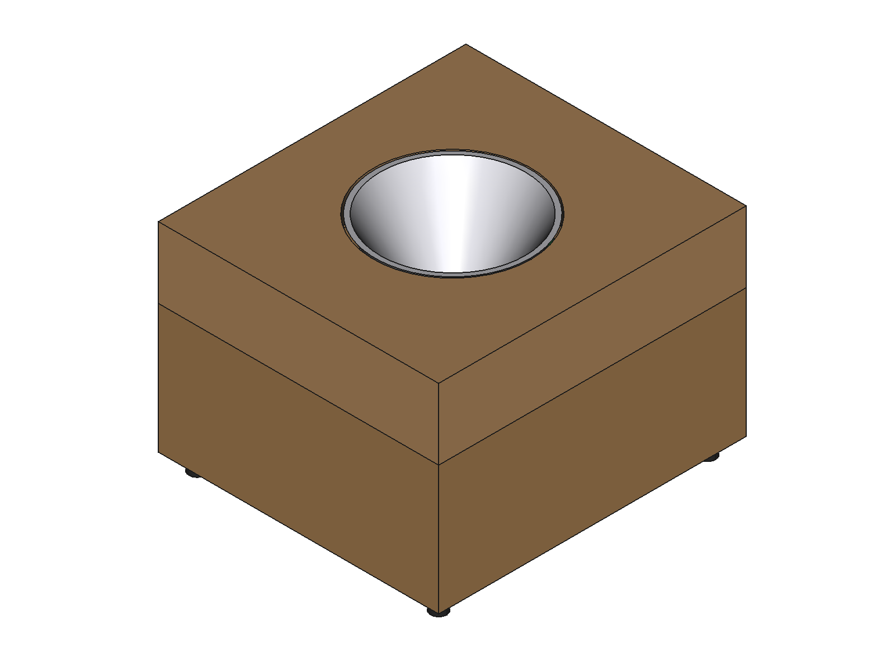

# RGBWYV-Light — mechanical

Parametric FreeCAD model of the RGBWYV-Light: the main board (KiCad STEP) in Doug's wooden box with the reflector cone,
LED heat sink, 3010 fan with a printed grill, LM317 heat sinks, the XIAO nRF52840 and AHT20 modules, the J1–J3 screw
terminals and the connector-face parts. Everything is driven by the **Params** spreadsheet in the FCStd (or the `P = dict(...)`
block in `build_assembly.py`); the **FitReport** text object lists every clearance.

## Files

| File | What it is |
|---|---|
| `build_assembly.py` | Builds the whole assembly, writes the FCStd, the assembly STEP, `parts/fan_grill_30mm.*` and the FitReport |
| `render_views.py` | Rebuilds and writes the PNGs in `renders/` (needs the GUI or `xvfb-run -a freecad render_views.py`) |
| `RGBWYV-Light_assembly.FCStd` | FreeCAD document (Params, FitReport, colours) |
| `RGBWYV-Light_assembly.step` | Same assembly as STEP |
| `RGBWYV-Light_PCB.step` | Main board exported from `../RGBYVW_Schematic_PCB/nRF52840_RGBWYV.kicad_pcb` (trimmed outline, J2/J3 screw terminals) |
| `parts/fan_grill_30mm.stl`, `.step` | Printable fan grill (print flat, outer face down, no supports) |
| `parts/Seeed_XIAO_nRF52840_v15.step` | Seeed XIAO model used for U10 |
| `renders/` | Closed, lid off, transparent, half-sections, connector face (straight + iso), fan side, underside/grill, board only |
| `renders/connector_face_check.png` | Face render with Doug's photo measurements (red +) over the model centres (blue o), plus the old/photo/new table |

Rebuild: `cd mechanical && flatpak run --command=freecadcmd org.freecad.FreeCAD build_assembly.py` (or `freecadcmd build_assembly.py`).
Coordinate frame: KiCad STEP with the origin at the board centre (PCB 124.715, 110.235): X = pcb_x − 124.715, Y = −(pcb_y − 110.235),
**Z = 0 at the board bottom**, +Z up to the lid. The connector face is the −X wall; seen from outside, +Y is on the left.

## Box and stack-up (final)

| | Value | Source |
|---|---|---|
| Box outside | 95.5 (Y) × 87 (X) × 62 high | measured (Doug) |
| Box inside | 81.5 × 70.0; walls 7.0 (ends, `WallSide`) / 8.5 (connector + back faces, `WallFB`) | measured |
| Floor | **3.0 mm everywhere** | measured |
| Lid | 22 mm deep cap (top surface to bottom edge), seam 40.0 mm up the outside; top plate 7.0 | depth measured, plate **assumed** |
| Standoffs | **M3 × 26** (board bottom 26.0 above the inside floor, top 27.6) | measured |
| Heights (z) | outer bottom −29.0, inside floor −26.0, board 0…1.6, seam 11.0, lid underside 26.0, lid top 33.0 | |
| Feet | 4 × Ø5 × 5 at x ±37.5, y ±41.75 (6 mm in from the corners); table z −34.0, 67 mm overall with feet | measured size, position chosen |

## Parts and how they fit

| Part | Model | Fit (from FitReport) |
|---|---|---|
| Reflector cone (B07MS8N2DS) | 48 mm mouth OD, 12 mm LED hole, 1.5 wall (assumed), **29.2 mm long** | top flush with the lid top (z 33.0 = 33.0), 0.5 mm radial gap in the Ø49 lid hole, 1.0 above D2 |
| LED D2 | placeholder 9 × 12 × 2.2 on the 12-pad footprint (**part unconfirmed**) | |
| LED sink uxcell 30×20×10 (B093V778LH) | centred on the LED under the board, channels along X (toward the vents), 0.25 pre-applied pad | z −10.25…−0.25; 5.75 above the fan, 0.79 to the nearest board part |
| Fan Sunon MF30100V1-1000U-A99 (3010) | flat on the floor, coaxial with the LED sink, Ø30 floor hole | z −26…−16; 3.64 to U6/U8 sinks |
| Fan grill (printed) | 36 × 36 × **2.0**, R3, hex 3.0 AF / 1.0 ribs, 2 mm solid ring, Ø29.6 × 1.0 locating ring, 4 × Ø3.4 90° countersinks (Ø6.9) on 24 mm | on the outside of the floor, 2.0 proud; **3.0 mm above the table** on the 5 mm feet |
| Grill screws | **4 × M3 × 18 flat head** + 4 M3 thin nuts (DIN 439, 1.8): grill 2 + floor 3 + fan 10 = 15 grip, 3 mm past the fan top | tips 2.8 below the LED sink |
| LM317 sinks Adam Tech HSK-059-04 (×6) | 10 W × 5.5 D extrusion, **35 mm stock cut to 20.0**; U5/U7 fin tips filed to 5.0 deep | z −21.5…−1.5: 4.5 above the floor; U5/U7 0.29 to the end wall; U6/U8 3.64 to the fan |
| LM317 leads (U4–U9) | clipped in the model to **1.5 mm** past the top (solder) side (KiCad model had 8.07) | |
| XIAO nRF52840 (U10) | on 2 × 1x7 male headers (2.54 plastic) — the same header part as the AHT20's 1x4 | underside z 4.14, top 8.60: **17.4 below the lid**, 8.9 to the cone; pins clipped to 1.5 above its PCB (were 4.75) |
| AHT20 UMLIFE (B09B9ZWSDZ) | 10.41 × 15.11 × 1.6 placeholder with 3×3×1 sensor on the board's 1x4 header | z 4.14…6.74, 5.15 to the +X wall; pins clipped to 1.5 above its PCB (were 4.40), incl. the KiCad header model |
| J1/J2/J3 screw terminals (JSZAAHZ kit B0FCXV6GT3) | XY308-2.54 style 2P/3P/4P, 8.5 tall, wire side facing −Y (**body size assumed**, listing has none) | 15.9 below the lid; J2 4.4 to the cone |
| Standoff screws | **M3 × 8 countersunk** through the 3 mm floor (5 mm into the standoff); M3 × 5–6 button head on top | |

## Connector face (−X wall, photo-matched)

Measured by Doug from his photo (±1.5 mm), d = from the LEFT end seen from outside, h = above the outer bottom (no feet).
The jack row is straightened to h 19.0 and the vents to h 33.2 (z = h − 29.0).

| Opening | d | h | Hole |
|---|---|---|---|
| 3.5 mm jack CESS 318 | 22.7 | 19.0 | Ø6.2 through, Ø12 inside counterbore leaving 3.0 (6 mm bushing, 2 mm nut outside) |
| DC jack uxcell B01C8CRCJ4 | 38.9 | 19.0 | Ø8.2 through, Ø12 inside counterbore leaving 4.5 (6.5 mm M8 thread **assumed**, 2 mm outside for washer + nut) |
| USB-C Amabro (slot horizontal) | 61.7 | 19.0 | 9.4 × 3.7 slot, 20.6 × 7.2 inside pocket (plate glued, no screws) |
| Plain holes Ø3 (no screws) | 5.9, 53.8, 68.8, 84.3 | 19.0 | Ø3 through |
| Vents (chrome eyelets Ø5) | 15.9, 30.8, 46.4, 61.3, 76.8 | 33.2 | Ø5; ring tops 2.05 below the seam |

Both jacks are modelled **20.0 mm overall** (Doug measured): DC jack X −45.5…−25.5 (thread 6.5 + body Ø11 × 9.5 + lugs 4.0),
3.5 mm jack X −46.5…−26.5 (bushing 6 + body Ø10 × 10.71 + lugs 3.29). Clearances: DC jack body 4.5 below the board,
USB-C 9.75 below the board, 3.5 mm jack 0.67 to the U4 body and 5.0 to the board.

## Assembly notes

* Cut the six HSK-059-04 sinks from 35 to 20 mm (2.9 off the top end, 12.1 off the bottom) so the M3 hole is 14.6 below the
  sink top; file 0.5 mm off the U5/U7 fin tips. M3 × 6 pan head into the sink's tapped hole; the tabs are live, keep sinks apart.
* Cut the reflector cone to 29.2 mm (listed 1.25" = 31.75).
* Clip the LM317 leads and the XIAO/AHT20 header pins about 1.5 mm past the solder joint.
* Fan grill: M3 × 18 flat heads up through grill, floor and fan, thin nuts on the fan top.

## KiCad changes made for this build

* Board outline trimmed 0.85 mm off each short end (62.29 × 82.69 → 62.29 × 80.99) to fit the 81.5 interior; GND zones pulled in.
  Original: `../RGBYVW_Schematic_PCB/nRF52840_RGBWYV.kicad_pcb.backup-pretrim`.
* J2 and J3 changed to `TerminalBlock_Xinya_XY308-2.54-3P/4P` (pad 1 and rotation kept, no tracks moved; they match the silk outlines on the board).
* 'LED Heatsink' zone (B.Cu, Net-(Q4-D)) = the 30 × 20 sink footprint, PCB 109.80,100.20 – 139.80,120.20; the B.Mask opening and the
  ground-plane cut-out follow it. Backups: `*.backup-preJ23zone`.
* DRC (KiCad 9.0.2): 60 items — 47 library-footprint notices, 6 silk-over-copper and 4 silk-edge (pre-existing), 2 silk overlaps and
  1 courtyard overlap J3/R14 (new); 0 unconnected.

## Assumed vs measured

Measured by Doug: box outside/inside, wall thicknesses, 3 mm floor, 22 mm lid depth, 26 mm standoffs, Ø30 fan hole, cone mouth,
connector-face positions, 20 mm jack lengths, 5 × 5 feet. From datasheets/listings: HSK-059-04 profile, uxcell sink, Amabro plate,
XIAO STEP, M8 thread on the DC jack. **Assumed:** lid top plate 7.0, cone wall 1.5, D2 emitter size, CESS 318 bushing/nut/body
proportions, DC jack thread length 6.5 and nut, screw-terminal bodies, USB-C PCB/receptacle details, AHT20 sensor block.

## Open issues

* **DC jack clashes with C1** (100 µF, CP_Radial D10 on the bottom side, hanging 10.1 below the board): 23 mm³ overlap with the jack body/lugs
  at the photo position. Needs C1 moved/laid over in KiCad or a shorter jack; not changed (Doug asked not to shift parts silently).
* **J3's wire side faces the AHT20** module 1.3 mm away (wires would run under it). Flip the AHT20 (`AhtDir`) or J3 (needs re-routing its 3 tracks).
* **J3/R14 courtyard overlap** (DRC error); ~0.7 mm between the J3 body and R14's pad copper.
* The FitReport's 2.6 mm³ "AHT20 vs PCB comps" is the KiCad header model's 4 pins passing through the module's holes (expected, not a clash).
* The schematic does not load in kicad-cli 9.0.2 on the build box (before or after the J2/J3 footprint-field edit); ERC not run here.
  Doug's KiCad is 10.0.8, so it may be a version issue.
* **LED pad insulation**: the LED's exposed pad is electrically live. Unless the uxcell sink's pad is confirmed insulating, keep a 3M 8810 layer.
* The schematic still calls J4 "Fan WINSINN 2010"; the fan is now a 3010 (Sunon MF30100V1-1000U-A99, check 5 V vs the circuit).
* The USB-drive copy of `BOM_R3_source.txt` was not updated.
* The board's 82.69 mm length did not fit the measured 81.5 interior, hence the outline trim (0.26 mm clearance per end now).
